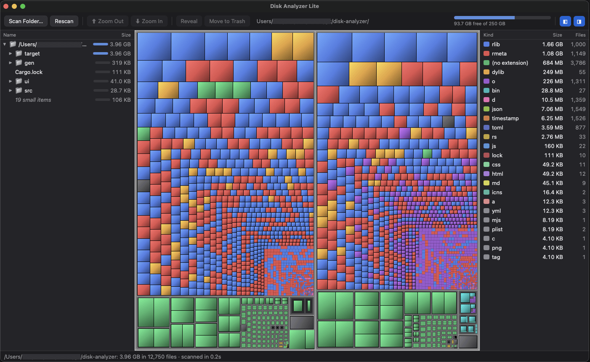

# Disk Analyzer Lite

**Visual treemap on your disk to free up space quickly.**

Disk Analyzer Lite is a fast, free and open-source disk usage analyzer for macOS and Linux. It scans a folder or your whole disk and draws everything as an interactive treemap: every file is a rectangle sized by the space it takes, so the biggest space hogs jump out at a glance.



## Why I built it

For years, [Disk Inventory X](https://www.derlien.com/) was one of the first apps I installed on every Mac that started getting low disk space warnings. Its treemap made it obvious where gigabytes had disappeared to: a forgotten VM image, a pile of old iOS backups, a `node_modules` folder that had grown out of control. I loved it.

But it has aged. It hasn't kept up with modern macOS, scans feel slow on today's SSDs and huge home folders, and it doesn't run on Linux at all. I wanted the same "aha" moment, rebuilt with today's tools: fast on today's disks, at home on macOS and Linux, and easy to keep improving. Disk Analyzer Lite is that app.

## Highlights

- **⚡ Fast.** Scans folders in parallel across all your CPU cores. A whole home folder usually takes seconds, not minutes.
- **🗺️ See everything at once.** A colorful, shaded treemap shows every file and folder in proportion to its size. Folder outlines get darker the deeper they're nested, so the structure is visible without hovering.
- **🎯 Honest numbers.** Sizes reflect the space actually used on disk, files that are linked to each other are counted only once, and other drives and network shares are never mixed in.
- **🔍 Explore your way.** Zoom into any folder, browse the synced folder tree, or click a file type (videos, disk images, archives…) to light up all of its files on the map.
- **🧹 Clean up safely.** Select one or many items and move them to the Trash in one go, with a confirmation first. Nothing is ever deleted outright.
- **📊 Watch the space come back.** A live disk gauge shows free space, what you've freed since the scan (even from Finder or the Terminal), and what is still waiting in the Trash.
- **🪶 Lightweight.** About 6 MB, starts instantly, and does nothing in the background: no timers, no telemetry, no network access.
- **🐧 macOS and Linux.** One app, same experience on both.

## Supported platforms

| Platform                      | Status           | Notes                                                                         |
| ----------------------------- | ---------------- | ----------------------------------------------------------------------------- |
| macOS 10.15 Catalina or later | ✅ Supported     | Apple Silicon and Intel                                                       |
| Linux (x86_64 and arm64)      | ✅ Supported     | Needs WebKitGTK 4.1: Ubuntu 22.04+, Debian 12+, Fedora 37+, Arch, and similar. Use the `.deb` on Debian/Ubuntu, the `.AppImage` (or build from source) elsewhere |
| Windows                       | ❌ Not supported | The scanner relies on Unix file metadata                                      |

## Quick start

1. **Install:** download the latest `.dmg` (macOS) or `.AppImage` / `.deb` (Linux) from the [Releases](../../releases) page, or [build it yourself](#build-from-source). Each release lists SHA-256 checksums in `SHA256SUMS.txt` (check with `shasum -a 256 -c SHA256SUMS.txt --ignore-missing`).
2. **Open the app** and choose **Home folder**, **Whole disk** or **Choose folder…**.
3. **Spot the big blocks.** The largest rectangles are the largest files. Hover for details, double-click to zoom into a folder.
4. **Clean up.** Select what you don't need (⌘/Ctrl-click for several), right-click → **Move to Trash**, and confirm.
5. **Empty the Trash** to actually free the space. The gauge at the top right turns solid green as space is freed.

> **Linux:** make the AppImage executable first (`chmod +x Disk*.AppImage`). On Arch, AppImages need `fuse2` (`sudo pacman -S fuse2`).
>
> **macOS:** the downloadable build isn't notarized yet. The first time you open it, right-click the app and choose **Open**. For complete scans, add the app under System Settings → Privacy & Security → **Full Disk Access**.

## Build from source

**1. Install the prerequisites**

- [Rust](https://rustup.rs) (stable, 1.77 or newer)
- **macOS:** Xcode Command Line Tools (`xcode-select --install`)
- **Linux:** WebKitGTK and friends:

  ```bash
  # Debian / Ubuntu
  sudo apt install build-essential libwebkit2gtk-4.1-dev libappindicator3-dev librsvg2-dev patchelf
  # Fedora
  sudo dnf install webkit2gtk4.1-devel libappindicator-gtk3-devel librsvg2-devel openssl-devel
  # Arch
  sudo pacman -S webkit2gtk-4.1 libappindicator-gtk3 librsvg base-devel
  ```

**2. Build**

```bash
git clone <this repository's URL>
cd disk-analyzer-lite
cargo install tauri-cli --version "^2" --locked
cargo tauri build
```

The installers end up in `target/release/bundle/`:

- **macOS:** `macos/Disk Analyzer Lite.app` (drag it to `/Applications`) and `dmg/*.dmg`
- **Linux:** `appimage/*.AppImage` (make it executable and run it) and `deb/*.deb` (`sudo apt install ./file.deb`)

To build only one format, add `--bundles app`, `--bundles dmg`, `--bundles appimage` or `--bundles deb`.

**3. Develop**

```bash
cargo run -- ~/Downloads     # run from source; the folder argument is optional
cargo test && npm test       # run the Rust and UI tests
```

## Using it

| Action                   | How                                                               |
| ------------------------ | ----------------------------------------------------------------- |
| Scan                     | **Scan Folder…**, or Home folder / Whole disk on the start screen |
| Select                   | Click a rectangle or a row in the tree                            |
| Select several           | ⌘-click (Ctrl-click on Linux); Shift-click for a range in the tree |
| Zoom in / out            | Double-click, Enter / Backspace or Esc                            |
| Highlight a file type    | Click it in the right-hand list                                   |
| Copy path, reveal, trash | Right-click, or the toolbar buttons (⌘⌫ / Ctrl+Backspace moves to Trash) |
| Hide side panels         | ◧ and ◨ at the top right                                          |

**Tip (macOS):** for complete results, add the app under System Settings → Privacy & Security → **Full Disk Access**. Otherwise macOS hides some folders, and the status bar shows how many items couldn't be read. The first time you move something to the Trash, macOS asks to let the app control Finder; allow it so you can use **Put Back** later.

**Tip (Linux):** a scan never crosses into another filesystem. If `/home` is its own partition, or you use btrfs subvolumes (the default layout on many Arch and Fedora installs), "Whole disk" only covers `/`: scan `/home` and other mount points separately. Items in folders you can't read (other users', system-owned) are counted as unreadable.

## How it works

Disk Analyzer Lite is a [Tauri 2](https://tauri.app) app: a Rust backend inside a native window, with a dependency-free HTML/JS frontend drawn on a `<canvas>`.

```
src/
  main.rs       Tauri commands (scan, cancel, trash, reveal, disk usage) and app setup
  scanner.rs    Parallel scanner and tree pruning
  fsops.rs      statvfs disk usage, safe move-to-trash, reveal in Finder / file manager
ui/
  index.html    Layout
  style.css     Light and dark themes
  treemap.js    Pure logic: squarified treemap layout, hit testing, tree helpers
  app.js        Rendering, interaction and calls to the backend
tests/ui/       Node tests for treemap.js
Info.plist      macOS: explains the Finder permission prompt (merged into the app bundle)
Entitlements.plist  macOS: permissions for signed/notarized builds
.github/        CI (lint + tests on macOS and Ubuntu) and the release workflow
```

**Scanning.** `scanner::scan` recurses with `rayon`, so each directory's subfolders are scanned in parallel. Sizes come from `st_blocks × 512` (allocated size, not apparent size). Hardlinks are counted once by `(dev, inode)`. Symlinks are never followed, and the scan never crosses into another device. Progress counters are atomics that a separate thread sends to the UI every 150 ms. Cancellation is a shared `AtomicBool` checked at each directory.

**Pruning.** A big disk can hold millions of files, far more than are worth sending to a webview. Before serializing, items smaller than `total / 150,000` are merged into one "N small items" bucket per folder. Totals stay exact, the JSON stays small, and every merged item would have been under a pixel anyway. Per-extension totals are computed during the scan, so the file-type list is exact too.

**Treemap.** `ui/treemap.js` implements the squarified treemap algorithm (Bruls, Huizing & van Wijk), padding folders so their borders can be drawn. Leaves get a diagonal gradient for a cushion-like look. The map uses three stacked canvases: the tiles, a dimming mask (selected folder, file-type filter) and hover/selection outlines. The tiles are only redrawn on layout changes, and hovering repaints just the outlines. Hit testing walks down the tree through a node→rect map instead of checking every rectangle.

**Safety.** Moving to the Trash uses the [`trash`](https://crates.io/crates/trash) crate, with the whole selection sent in one batch on a background thread so the window never freezes. The backend refuses relative paths, paths containing `..`, `/` and your home folder. The webview runs under a strict Content Security Policy.

**Platform integration.** Reveal uses `open -R` on macOS. On Linux it asks the file manager to select the item through the `org.freedesktop.FileManager1` D-Bus interface (Nautilus, Dolphin, Nemo, Caja, Thunar…) and falls back to `xdg-open` on the folder. The Trash follows the freedesktop.org spec on Linux and goes through Finder on macOS, so Put Back works. On Linux the app turns off WebKitGTK's DMA-BUF renderer, which shows a blank window on many NVIDIA and some Wayland setups; set `WEBKIT_DISABLE_DMABUF_RENDERER=0` to keep it.

**Disk gauge.** `statvfs` is queried after a scan, after trashing, and whenever the window regains focus. There is no polling. "Freed" is the increase in free space since the scan.

### Known limitations

- Files whose names aren't valid UTF-8 are shown with replacement characters and can't be trashed from the app.
- On Linux, trashing files on a USB drive or another partition only works if that drive supports a Trash folder (most do; some read-only or FAT drives don't).
- Files merged into "small items" buckets can't be selected individually; zoom in and rescan that folder for detail.

## Contributing

Contributions are welcome! See [CONTRIBUTING.md](CONTRIBUTING.md). Run `cargo test` and `npm test` before opening a pull request.

## Author

Created by **[Xavi Esteve](https://xaviesteve.com)**.

## License

[MIT](LICENSE) © 2026 [Xavi Esteve](https://xaviesteve.com)
